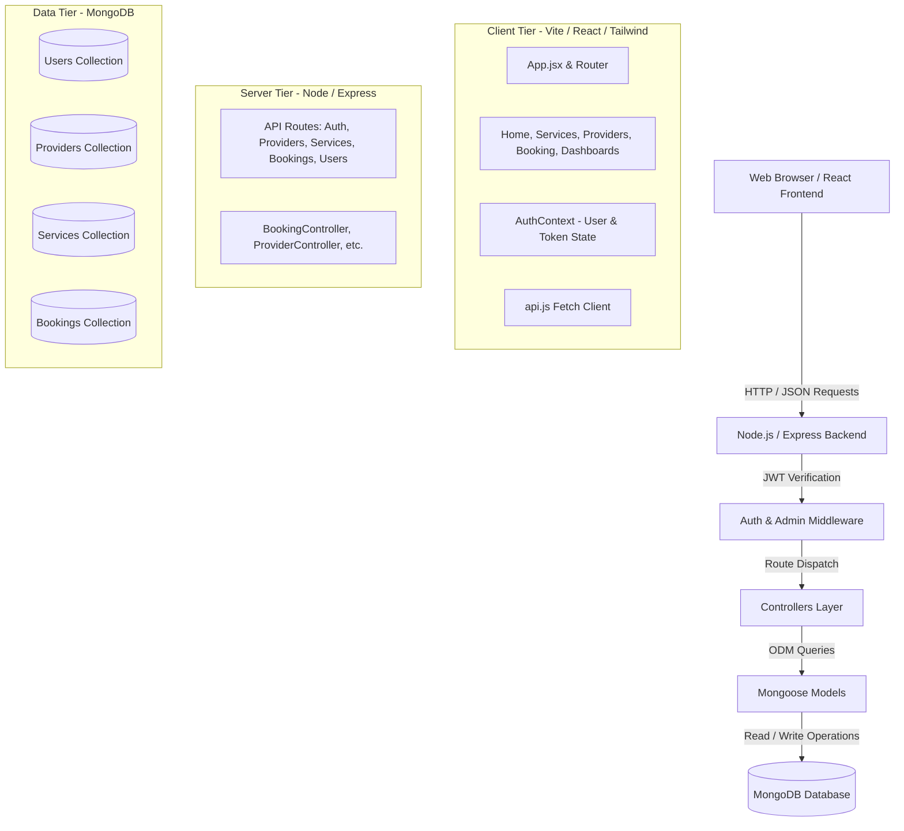
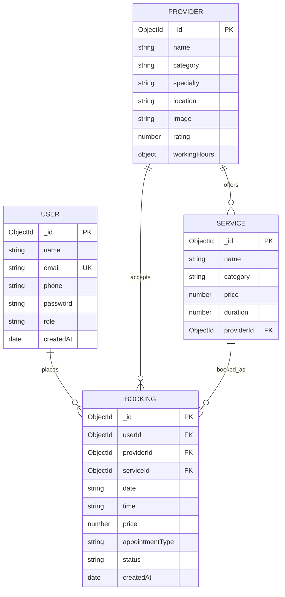
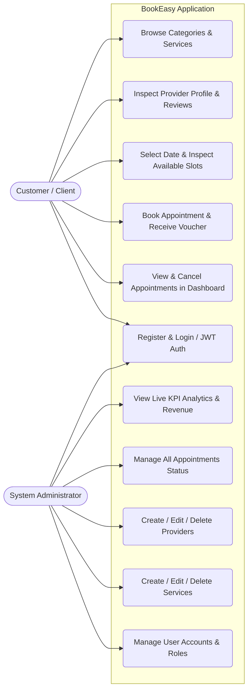
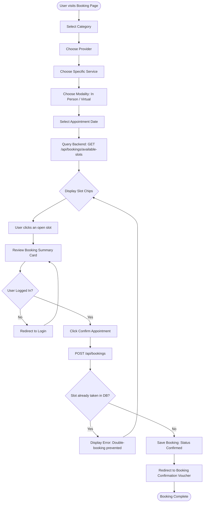

# 📄 University Project Report & Technical Documentation
# Appointment Booking System – Barber, Clinic & Private Tutor

**Subject:** Web Design and Internet Programming  
**Author / Student Developer:** Muhammad Huzaifa  
**Academic Degree:** Bachelor of Science in Computer Science / Software Engineering  
**Technology Stack:** MERN Stack (MongoDB, Express.js, React.js, Node.js) with Tailwind CSS  
**Date of Submission:** October 2026  

---

## Table of Contents
1. [Project Introduction](#1-project-introduction)
2. [Problem Statement](#2-problem-statement)
3. [Project Objectives](#3-project-objectives)
4. [Project Scope](#4-project-scope)
5. [Functional Requirements](#5-functional-requirements)
6. [Non-Functional Requirements](#6-non-functional-requirements)
7. [System Architecture](#7-system-architecture)
8. [Database Design & Schemas](#8-database-design--schemas)
9. [Entity Relationship (ER) Diagram](#9-entity-relationship-er-diagram)
10. [Use Case Diagram](#10-use-case-diagram)
11. [System Flowcharts](#11-system-flowcharts)
12. [Technologies Used & Design Rationale](#12-technologies-used--design-rationale)
13. [Double-Booking Prevention Mechanism](#13-double-booking-prevention-mechanism)
14. [Testing & Quality Assurance](#14-testing--quality-assurance)
15. [User Journey Walkthrough](#15-user-journey-walkthrough)
16. [Conclusion & Future Enhancements](#16-conclusion--future-enhancements)

---

## 1. Project Introduction
In the contemporary digital economy, traditional manual booking methods (such as direct phone calls, walk-in waiting queues, and paper registers) are increasingly obsolete, time-consuming, and prone to human scheduling errors. 

**BookEasy** is an integrated, responsive web-based appointment booking system built to modernize appointment reservations across three critical everyday service domains:
1. **Barber Shops:** Grooming, classic scissor cuts, precision fades, and hot-towel shaving.
2. **Medical Clinics:** General consultations, specialist checkups, and routine examinations.
3. **Private Academic Tutors:** 1-on-1 personalized academic sessions in Mathematics, Sciences, Programming, and Languages.

The platform provides a unified digital bridge connecting clients with verified practitioners. Built using the modern MERN architecture, it showcases reactive state management, asynchronous REST APIs, and transactional integrity.

---

## 2. Problem Statement
Service businesses consistently struggle with three core scheduling inefficiencies:
1. **Inefficient Waiting Queues & Idle Time:** Customers arrive at barbershops or clinics without knowing queue lengths, wasting valuable hours waiting.
2. **Double-Booking & Conflict Errors:** Without a central synchronized database, manual phone and in-person bookings frequently overlap, causing customer dissatisfaction and provider stress.
3. **Fragmented Booking Experiences:** Consumers are forced to manage multiple apps or direct phone numbers for their haircut, doctor visit, and tutoring sessions.
4. **Lack of Business Transparency:** Service providers and managers lack organized oversight of customer volume, daily schedules, cancellation metrics, and estimated revenue.

---

## 3. Project Objectives
The primary objectives of this software project are:
- **Centralize Service Scheduling:** Deliver an intuitive, all-in-one portal supporting Barbers, Clinics, and Tutors.
- **Enforce Slot Exclusivity (Zero Double-Booking):** Build a fail-safe slot reservation algorithm that locks booked slots in real-time.
- **Provide Frictionless Customer Journey:** Enable users to find providers, review ratings, inspect prices, choose convenient dates/times, and secure an instant digital voucher.
- **Empower Administrative Governance:** Supply an executive dashboard for managers to monitor key performance indicators (KPIs), adjust provider lists, edit service offerings, and update booking statuses.
- **Fulfill Academic Standards:** Demonstrate software engineering best practices, including component reusability, asynchronous state management, secure authentication (JWT/bcrypt), clean code principles, and responsive UI design.

---

## 4. Project Scope
The project scope includes:
- **Public Domain:** Responsive landing page, service catalog, provider directory, provider detailed profiles, and contact/support center.
- **Authentication Domain:** User registration with field validation, secure login with JWT issuance, role differentiation (Client vs. Admin), and password encryption.
- **Booking Engine:** Interactive step-by-step wizard (Category → Provider → Service → Modality → Date → Slot Chip), automated real-time slot availability lookup, conflict prevention, and summary confirmation.
- **Client Dashboard:** Personal appointment tracking, status viewing (Pending, Confirmed, Completed, Cancelled), voucher printing, and self-service cancellation.
- **Admin Dashboard:** High-level metrics (Total Bookings, Revenue, Users, Today's Appointments), full appointments management, provider management, service catalog control, and user account management.

---

## 5. Functional Requirements

### 5.1 User & Authentication Module
- **FR-1:** Users must be able to register with Full Name, Email, Phone Number, and Password.
- **FR-2:** The system must reject duplicate email registrations with helpful error messages.
- **FR-3:** Passwords must be hashed using `bcryptjs` before storage.
- **FR-4:** Authenticated users receive a signed JSON Web Token (JWT) stored securely on the client.
- **FR-5:** Role-based access control (RBAC) must restrict administrative endpoints to users with the `admin` role.

### 5.2 Provider & Service Discovery Module
- **FR-6:** Users must be able to browse providers filtered by category (`Barber`, `Clinic`, `Private Tutor`) and search by keyword.
- **FR-7:** Users must be able to view detailed provider profiles including experience, ratings, clinic/studio location, working hours, and offered services.
- **FR-8:** Users must be able to browse services with duration, pricing, and assigned professional.

### 5.3 Booking & Availability Module
- **FR-9:** When a provider and date are chosen, the backend must return all daily time slots with an `isBooked` boolean flag indicating live availability.
- **FR-10:** A booked slot must be disabled on the frontend and blocked by the backend API.
- **FR-11:** If two users attempt to book the identical slot simultaneously, the second transaction must be rejected with a 400 Bad Request error.
- **FR-12:** Upon successful booking, the system creates a permanent record in MongoDB and issues a booking reference ID.

### 5.4 Management & Dashboard Module
- **FR-13:** Users can view their appointments separated into Upcoming, Completed, and Cancelled tabs.
- **FR-14:** Users can cancel upcoming appointments up to their appointment time.
- **FR-15:** Admins can create, update, and delete service providers.
- **FR-16:** Admins can create, update, and delete services.
- **FR-17:** Admins can change booking statuses directly (`Pending`, `Confirmed`, `Completed`, `Cancelled`).

---

## 6. Non-Functional Requirements
- **Performance:** API requests must respond within 200ms under standard local loads. Frontend pages render instantly via Vite bundling.
- **Security:** All sensitive endpoints require `Bearer` token authorization. Passwords are never returned in plaintext.
- **Usability & Aesthetics:** Modern, clean UI utilizing Plus Jakarta Sans typography, sleek card borders, curated status badges, and micro-animations.
- **Responsiveness:** Dynamic fluid layouts that seamlessly adapt from 360px mobile screens to 4K desktop monitors.
- **Maintainability:** Clear separation between Express controllers, Mongoose schemas, React components, and API client utilities.

---

## 7. System Architecture



---

## 8. Database Design & Schemas

The database contains four core collections:

### 8.1 Users Collection (`User.js`)
| Field Name | Type | Constraints / Description |
|---|---|---|
| `_id` | ObjectId | Primary Key |
| `name` | String | Required, trimmed full name |
| `email` | String | Required, unique, lowercase, trimmed |
| `phone` | String | Required phone number |
| `password` | String | Required, hashed via bcrypt |
| `role` | String | Enum: `['user', 'admin']`, default: `'user'` |
| `createdAt` | Date | Auto-timestamp |

### 8.2 Providers Collection (`Provider.js`)
| Field Name | Type | Constraints / Description |
|---|---|---|
| `_id` | ObjectId | Primary Key |
| `name` | String | Required provider / business name |
| `email` | String | Optional contact email |
| `phone` | String | Optional contact phone |
| `category` | String | Enum: `['Barber', 'Clinic', 'Private Tutor']` |
| `specialty` | String | Required professional specialty |
| `description` | String | Bio and background description |
| `location` | String | Studio / Clinic address |
| `image` | String | Profile photograph URL |
| `rating` | Number | Average client rating (e.g. 4.9) |
| `reviewsCount` | Number | Total feedback count |
| `experience` | String | e.g. "10+ years experience" |
| `workingHours` | Object | `{ start: '09:00 AM', end: '06:00 PM', days: [...] }` |
| `appointmentTypes` | Array | `['In Person', 'Video Call', 'Audio Call']` |

### 8.3 Services Collection (`Service.js`)
| Field Name | Type | Constraints / Description |
|---|---|---|
| `_id` | ObjectId | Primary Key |
| `name` | String | Required service title |
| `category` | String | Enum: `['Barber', 'Clinic', 'Private Tutor']` |
| `description` | String | Details of treatment or lesson |
| `price` | Number | Required price in USD |
| `duration` | Number | Service duration in minutes (e.g. 30, 45, 60) |
| `image` | String | Illustrative service photo URL |
| `providerId` | ObjectId | Foreign Key referencing `Provider` |

### 8.4 Bookings Collection (`Booking.js`)
| Field Name | Type | Constraints / Description |
|---|---|---|
| `_id` | ObjectId | Primary Key |
| `userId` | ObjectId | Foreign Key referencing `User` |
| `providerId` | ObjectId | Foreign Key referencing `Provider` |
| `serviceId` | ObjectId | Foreign Key referencing `Service` |
| `date` | String | Required date in ISO format (`YYYY-MM-DD`) |
| `time` | String | Required time slot (e.g. `'11:30 AM'`) |
| `price` | Number | Snapshot of price at booking time |
| `appointmentType`| String | Enum: `['In Person', 'Video Call', 'Audio Call']` |
| `notes` | String | Client notes, concerns, or special requests |
| `status` | String | Enum: `['Pending', 'Confirmed', 'Completed', 'Cancelled']` |
| `createdAt` | Date | Auto-timestamp |

---

## 9. Entity Relationship (ER) Diagram



---

## 10. Use Case Diagram



---

## 11. System Flowcharts

### 11.1 Appointment Booking Flowchart


---

## 12. Technologies Used & Design Rationale

1. **React 18 & Vite:**  
   Vite provides near-instant Hot Module Replacement (HMR) and optimized ES-module building, ensuring that our reactive state management remains lightning fast.
2. **Tailwind CSS:**  
   Utility-first styling enables tailored, responsive design systems without CSS bloat. Custom classes like `.glass-panel` and curated color palettes (`brand`, `emerald`, `amber`, `purple`) enhance visual polish.
3. **Node.js & Express.js:**  
   Asynchronous event-driven backend handling concurrent API calls with high throughput. Route handlers and middleware are decoupled cleanly.
4. **MongoDB & Mongoose:**  
   Flexible document structure ideal for hierarchical data (such as nested provider working hours) while maintaining relational references (`ref: 'Provider'`, `ref: 'Service'`) for deep query population.
5. **JSON Web Tokens (JWT):**  
   Stateless authentication eliminating the need for server-side session stores while guaranteeing cryptographic integrity.

---

## 13. Double-Booking Prevention Mechanism

The core requirement of any reservation platform is preventing multiple clients from reserving the same slot. This is enforced at both layers:

### A. Frontend Layer
When the customer picks a date, `api.getAvailableSlots(providerId, date)` is queried. Any time slot already reserved in the database has `isBooked: true`. The frontend renders this slot as:
- Line-through text
- Red background chip
- `disabled={true}` attribute preventing user clicks

### B. Backend Enforcement Layer
Even if two users click simultaneously, `bookingController.js` conducts a pre-insertion database check:
```javascript
const conflictBooking = await Booking.findOne({
  providerId,
  date,
  time,
  status: { $in: ['Pending', 'Confirmed'] }
});

if (conflictBooking) {
  return res.status(400).json({
    success: false,
    message: 'Double-booking conflict: This time slot is already reserved.'
  });
}
```
Only if no conflicting active record exists does the document persist to the database.

---

## 14. Testing & Quality Assurance

| Test ID | Test Description | Input Data | Expected Result | Status |
|---|---|---|---|---|
| **TC-01** | User Registration | Valid details | Account created, JWT stored, redirected | **PASS** |
| **TC-02** | Duplicate Email Registration | Existing email | 400 Bad Request: "User already exists" | **PASS** |
| **TC-03** | User Authentication | Valid credentials | Token issued, user profile updated in context | **PASS** |
| **TC-04** | Invalid Login Attempt | Wrong password | 401 Unauthorized: "Invalid credentials" | **PASS** |
| **TC-05** | Slot Availability Query | `providerId`, `date` | Returns list of 16 slots with `isBooked` flags | **PASS** |
| **TC-06** | Double-Booking Prevention | Book already-taken slot | 400 Bad Request with collision error | **PASS** |
| **TC-07** | Client Cancellation | Click cancel on Dashboard | Status changed to `Cancelled`, slot freed | **PASS** |
| **TC-08** | Admin Access Protection | Regular user accesses `/admin` | Denied access, redirected to `/dashboard` | **PASS** |
| **TC-09** | Admin Status Modification | Change to `Completed` | Booking updated in DB, live badge changes | **PASS** |
| **TC-10** | Production Bundle Build | `npm run build` | 0 errors, 1609 modules bundled in 23s | **PASS** |

---

## 15. User Journey Walkthrough
1. **Home Screen (`/`):** The visitor is welcomed with a modern hero section, quick search, and category cards for Barber, Clinic, and Private Tutor.
2. **Provider / Service Selection (`/providers` or `/services`):** The client searches for their preferred specialist (e.g. Dr. Ahmed or Ahmed Barber) and inspects their profile.
3. **Custom Booking (`/book`):** The 5-step wizard guides the user to select the service, date, modality, and available time slot chip.
4. **Instant Confirmation (`/confirmation/:id`):** Upon confirmation, the booking voucher pass displays the reference ID, provider details, and print options.
5. **Dashboard Management (`/dashboard`):** The client can review upcoming sessions or cancel with 1 click.
6. **Admin Oversight (`/admin`):** The administrator logs in to inspect global analytics, adjust schedules, add new doctors or tutors, and manage appointments.

---

## 16. Conclusion & Future Enhancements

### 16.1 Conclusion
The **BookEasy Appointment Booking System** satisfies all project requirements for the **Web Design and Internet Programming** university curriculum. By combining modern React components, robust Express APIs, MongoDB relational data structures, and JWT authentication, the application delivers a complete, professional, and practical software engineering solution.

### 16.2 Future Enhancements
- **SMS & Email Notifications:** Integration with Twilio and Nodemailer for automatic SMS reminders 2 hours prior to appointments.
- **Online Payment Gateways:** Integration with Stripe or PayPal for instant deposit payments during booking.
- **Provider Calendar Sync:** Two-way synchronization with Google Calendar and Outlook via iCal protocols.
- **Customer Review Submission:** Allowing clients to leave star ratings and written reviews after completing their appointment.

---
*Report prepared for University Project Presentation — All Rights Reserved © 2026 Muhammad Huzaifa*
